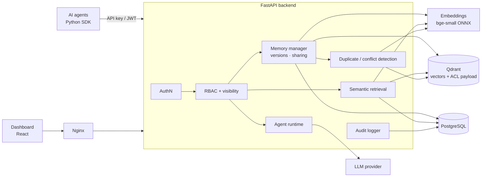

# Shared Memory Layer for Cross-Team AI Agents

A secure, persistent, semantically searchable **organisational memory** that lets autonomous AI agents
from different teams store knowledge, find what other teams' agents already learned, share decisions
and keep versioned history — with authentication, role-based access control, per-memory visibility
and a complete audit trail enforced by the server.

```
AI agents ──► Agent gateway / REST API ──► Authentication ──► Authorisation (RBAC + visibility)
          ──► Memory manager ──► Semantic retrieval
          ──► [ Qdrant vectors | PostgreSQL metadata | versions | access control | audit log ]
          ──► Admin dashboard (React)
```

> Agent A → Shared Memory → Agent B — agents never need to talk to every other agent directly.

---

## Contents

1. [Project overview](#1-project-overview)
2. [Problem statement](#2-problem-statement)
3. [Objectives](#3-objectives)
4. [Features](#4-features)
5. [Architecture](#5-architecture)
6. [Technology stack](#6-technology-stack)
7. [Database architecture](#7-database-architecture)
8. [API documentation](#8-api-documentation)
9. [Security architecture](#9-security-architecture)
10. [Installation](#10-installation)
11. [Running locally](#11-running-locally)
12. [Demo instructions](#12-demo-instructions)
13. [Testing](#13-testing)
14. [Evaluation methodology and results](#14-evaluation-methodology-and-results)
15. [Future scope](#15-future-scope)

Further documents: [**deploying to a server (HTTPS)**](docs/deployment.md) · [integrations (MCP, SDKs, CLI, import)](docs/integrations.md) · [architecture](docs/architecture.md) · [security](docs/security.md) ·
[database](docs/database.md) · [API](docs/api.md) · [setup & operations](docs/setup.md) ·
[evaluation](docs/evaluation.md) · [academic documentation](docs/academic.md) (abstract, literature survey,
research gap) · [SDK](sdk/README.md)

---

## 1. Project overview

The system is a complete, runnable monorepo:

| Part | Path | Description |
|---|---|---|
| Backend | `backend/` | FastAPI service: auth, RBAC, memory lifecycle, semantic search, versioning, sharing, duplicate/conflict detection, audit, agent runtime |
| Frontend | `frontend/` | React + Vite + TypeScript dashboard (dashboard, explorer, memory detail, agents, teams, access control, audit, playground, review) |
| SDKs & CLI | `sdk/`, `sdk-js/` | Python `MemoryClient` + `sml` CLI + importers + LLM tool definitions; zero-dependency TypeScript client |
| MCP server | `backend/app/mcp_server.py` | Model Context Protocol endpoint at `/mcp` for Claude Code, Cursor, VS Code, Claude Desktop |
| Evaluation | `evaluation/` | labelled dataset + benchmark comparing isolated vs. shared memory |
| Infrastructure | `docker-compose.yml`, `infrastructure/` | PostgreSQL, Qdrant, backend, nginx-served frontend, optional Ollama |
| Scripts | `scripts/` | `.env` generator, acceptance scenario, secret scanner |

## 2. Problem statement

AI agents in separate teams keep isolated memories. The result is duplicated work, repeated
reasoning, information silos and inconsistent decisions. Pooling everything in one vector database
would fix sharing but break confidentiality — semantic search would happily return another team's
confidential incident because it is *similar*. The goal is a memory layer that is **shared**,
**semantic**, **versioned**, **secure by construction** and **auditable**. (Details:
[docs/academic.md](docs/academic.md).)

## 3. Objectives

Secure knowledge sharing · semantic retrieval · reduced redundant work · cross-team collaboration ·
memory versioning · fine-grained access control · auditability · scalability and replaceable components.

## 4. Features

**Memory management**
- 9 memory types: knowledge, decision, learning, experience, context, task result, incident, documentation, solution
- full metadata: creator agent/user, team, project, tags, importance, confidence, reliability, verification, visibility, sensitivity, status, source & source ref, expiry, embedding id/model, parent memory, allowed teams/agents
- lifecycle CREATE → VALIDATE → EMBED → STORE → RETRIEVE → USE → UPDATE → VERSION → ARCHIVE; archive/restore; admin-only permanent delete
- every update creates an immutable version (author, timestamp, change description, snapshot, previous version); optimistic locking with `expected_version`
- provenance: who created it, team, source, versions, who modified it, who accessed it (from the audit log)

**Real-world access**
- **MCP endpoint** (`/mcp`): any MCP client — Claude Code, Cursor, VS Code, Claude Desktop — gets `search_memory`, `remember`, `get_memory`, `update_memory`, `share_memory`, `memory_history`, `list_teams`, `whoami` with just a URL and an agent API key
- **Connect an agent** page in the dashboard: issues a key and produces copy-paste setup for MCP clients, Python, TypeScript, CLI, LLM tools and curl
- **Import existing knowledge**: drop Markdown/JSON/CSV files (or paste) in the dashboard, `sml import ./docs`, or `POST /api/memories/bulk` — split by section, deduplicated, idempotent re-runs
- **Python SDK + `sml` CLI**, **TypeScript SDK** (Node/Deno/Bun/browser), ready-made **OpenAI/Anthropic tool definitions**
- **Accessible dashboard**: keyboard-navigable tabs and dialogs (focus trap/restore), skip link, visible focus, WCAG-AA text contrast, reduced-motion support, mobile navigation drawer

**Hybrid semantic search**
- local embeddings (`BAAI/bge-small-en-v1.5` via fastembed/ONNX — no API key); Ollama/OpenAI embedding providers configurable
- **hybrid** by default: embeddings + PostgreSQL full-text search under the same permission filter, so exact identifiers (error codes, CVE ids, ticket numbers) are found as reliably as paraphrases; `semantic` / `keyword` modes available
- Qdrant similarity search with **access-control filters inside the index** + authoritative re-check in PostgreSQL
- top-k, similarity threshold, filters by type, team, creator agent, project, tags, visibility, verification, confidence, dates; include expired/archived
- trust-aware ranking (similarity + importance + confidence + verification); graceful keyword fallback if Qdrant is down

**Sharing & access control**
- visibility levels PRIVATE, TEAM, SELECTED_TEAMS, SELECTED_AGENTS, ORGANIZATION; explicit sharing grants per team/agent; per-team sharing policy
- roles ADMIN, TEAM_MANAGER, AGENT, READ_ONLY; 16 permissions stored in the DB and editable at runtime
- field-level protection: cross-team readers never receive owner-side fields

**Quality & governance**
- semantic + exact **duplicate detection** ("Potential duplicate memories found." — never auto-deleted; optional `reject_on_duplicate` → 409)
- **conflict detection** (key/value, decision-choice and negation rules on semantically similar memories) → review queue with keep-new / keep-existing / keep-both / dismiss
- verification workflow (unverified / verified / rejected), feedback ratings → reliability score
- append-only audit log (DB trigger) covering logins, failures, reads, searches, writes, sharing, denials, role changes …

**Agents & LLM**
- per-agent identities, roles and hashed, revocable API keys (or JWT exchange)
- Python SDK with retries, token refresh and typed errors
- memory-augmented agent runtime: task → search → memories as context → LLM → answer → optional new memory; LLM provider configurable (none/extractive, Ollama, OpenAI-compatible, Anthropic)
- Agent Playground in the UI to act as any agent (with *its* permissions) — search, ask, store, access test

**Operations**
- one-command Docker Compose deployment, Alembic migrations, seeded demo organisation
- rate limiting, consistent JSON errors, request ids, JSON logs, Prometheus metrics, health checks, consistency check & re-index

## 5. Architecture



Semantic search pipeline: *query → embedding → vector search with permission + metadata filter →
PostgreSQL re-check → ranking → top-k*. Restricted memories are never returned merely because they
are similar. Full description: [docs/architecture.md](docs/architecture.md).

## 6. Technology stack

| Layer | Technology |
|---|---|
| API | Python 3.12, FastAPI, Pydantic v2, Uvicorn; MCP (official `mcp` SDK 2.x, Streamable HTTP) |
| Persistence | PostgreSQL 16 (+ generated `tsvector` full-text index), SQLAlchemy 2, Alembic, psycopg 3 |
| Vector search | Qdrant 1.13 (cosine, HNSW, payload indexes) |
| Embeddings | fastembed + ONNX Runtime, `BAAI/bge-small-en-v1.5` (384-d); optional Ollama/OpenAI |
| LLM | pluggable: extractive (default), Ollama, OpenAI-compatible, Anthropic |
| Security | PyJWT (HS256), argon2-cffi (Argon2id), keyed SHA-256 for API keys/refresh tokens |
| Frontend | React 18, Vite 5, TypeScript, TanStack Query, React Router, Recharts, lucide-react |
| Serving | nginx (SPA + reverse proxy, CSP) |
| Observability | JSON logs, Prometheus client, audit log |
| Testing | pytest (real PostgreSQL/Qdrant/embeddings), httpx MockTransport for the SDK |
| Packaging | Docker, Docker Compose |

## 7. Database architecture

Normalised PostgreSQL schema created by Alembic: `users`, `agents`, `teams`, `roles`, `permissions`,
`role_permissions`, `agent_roles`, `memories`, `memory_versions`, `memory_access`, `memory_tags`, `tags`,
`projects`, `audit_logs`, `api_keys`, `refresh_tokens`, `memory_feedback`, `memory_conflicts` — with
foreign keys, CHECK constraints (score ranges, exactly-one-target grants, enum values) and indexes on
`team_id`, `agent_id`, `memory_type`, `created_at`, `visibility`, `status` and more. Qdrant holds one
vector per memory with the payload needed for filtering. ER diagram and column reference:
[docs/database.md](docs/database.md).

## 8. API documentation

Swagger UI at **`/docs`**, ReDoc at `/redoc`, OpenAPI at `/openapi.json`. Main endpoints:

```
POST /api/auth/register | login | refresh | logout | agent-token      GET /api/auth/me
POST /api/agents   GET /api/agents   GET|PATCH|DELETE /api/agents/{id}   PUT /api/agents/{id}/roles
POST /api/teams    GET /api/teams    GET|PATCH /api/teams/{id}           GET|POST /api/projects
POST /api/memories  GET /api/memories  GET|PATCH|DELETE /api/memories/{id}
POST /api/memories/search   POST /api/memories/check   POST /api/memories/bulk
GET  /api/memories/{id}/versions   GET /api/memories/{id}/versions/{version}   GET /api/memories/{id}/provenance
POST /api/memories/{id}/share      DELETE /api/memories/{id}/share/{target}
POST /api/memories/{id}/feedback   POST /api/memories/{id}/verify   POST /api/memories/{id}/restore
GET  /api/audit-logs   GET /api/dashboard/stats   GET /api/conflicts   POST /api/conflicts/{id}/resolve
POST /api/agent-runtime/tasks      POST /api/playground/{search,tasks,memories,access-check}
GET  /api/users  PATCH /api/users/{id}  GET /api/roles  GET /api/permissions  PUT /api/roles/{id}/permissions
POST /api/admin/reindex  GET /api/admin/consistency  GET /api/admin/config
GET  /health  GET /health/live  GET /metrics
POST /mcp   (Model Context Protocol, X-API-Key)
```

Connecting an agent in one line (Claude Code):

```bash
claude mcp add --transport http shared-memory http://localhost:3000/mcp --header "X-API-Key: $SML_API_KEY"
```

More clients (Cursor, VS Code, Claude Desktop, Python, TypeScript, CLI): [docs/integrations.md](docs/integrations.md).

Request/response examples: [docs/api.md](docs/api.md). Search response:

```json
{"query": "authentication problem", "mode": "semantic", "total": 1, "took_ms": 48.2, "threshold": 0.55,
 "results": [{"memory_id": "…", "title": "JWT authentication issue", "content": "…", "similarity": 0.91,
              "team": "Development", "memory_type": "learning", "confidence": 0.92, "version": 2, "cross_team": true}]}
```

## 9. Security architecture

- **Authentication**: JWT access tokens (15 min) + rotating refresh tokens with reuse detection;
  agents use per-agent API keys (hashed, revocable, expiring); Argon2id passwords with a password
  policy, lockout after repeated failures; no secret has a default.
- **Authorisation**: RBAC permissions (configurable) + per-memory visibility evaluated in the API, in
  SQL and inside the Qdrant filter; ownership checks for update/share/archive; privilege-escalation guards.
- **Privacy**: least privilege, data isolation per team, field-level filtering, duplicate/conflict
  warnings that never reveal unreadable memories.
- **Auditability**: append-only audit log (DB trigger) including every denial with its reason.
- **Hardening**: input validation, XSS/SQL-injection protection, CSP and security headers, rate
  limiting, consistent errors without stack traces, internal-only databases, API-key-protected Qdrant.

Details and threat model: [docs/security.md](docs/security.md).

## 10. Installation

Requirements: Docker with Compose v2 (Docker Desktop on Windows/macOS; x86-64 or ARM64) and Python 3
on the host for the one-off `.env` generator.

```bash
git clone <repo> shared-memory-layer && cd shared-memory-layer
python scripts/generate_env.py        # creates .env with random secrets and prints the admin password
```

(Alternatively copy `.env.example` to `.env` and fill in the secrets by hand.)

## 11. Running locally

```bash
docker compose up --build
```

| URL | |
|---|---|
| http://localhost:3000 | dashboard — log in as **`admin`** with `ADMIN_PASSWORD` from `.env` |
| http://localhost:8000/docs | Swagger UI |
| http://localhost:8000/health | component health |

Ports are configurable with `BACKEND_PORT` / `FRONTEND_PORT` in `.env`. Optional local LLM:
`docker compose --profile llm up -d` + `LLM_PROVIDER=ollama` (see [docs/setup.md](docs/setup.md#4-optional-local-llm-with-ollama)).

**Deploying to a server.** On any Linux VM with Docker (2 vCPU / 4 GB RAM, ports 80 and 443 open) and a domain
name pointing at it — or `<server-ip-with-dashes>.sslip.io` without one:

```bash
git clone https://github.com/mardromus/SharedMemoryLayer.git && cd SharedMemoryLayer
scripts/deploy.sh memory.example.com      # secrets, build, start, HTTPS certificate, health check
```

`docker-compose.prod.yml` puts Caddy in front for automatic Let's Encrypt HTTPS, publishes only ports 80/443,
runs the backend in production mode (secure cookies, per-client rate limits behind the proxy) and rotates logs.
Updates are `git pull && scripts/deploy.sh`; `scripts/backup.sh` dumps the database. Step-by-step guide,
backups/restore and troubleshooting: [docs/deployment.md](docs/deployment.md).

**Demo credentials** (created on first start):

| Account | Password | Role |
|---|---|---|
| `admin` | `ADMIN_PASSWORD` in `.env` | ADMIN |
| `dev.lead`, `qa.lead`, `sec.lead`, `support.lead` | `DEMO_USER_PASSWORD` in `.env` | TEAM_MANAGER of their team |
| `auditor` | `DEMO_USER_PASSWORD` in `.env` | READ_ONLY |
| Dev-Agent, QA-Agent, Security-Agent, Support-Agent | issue an API key in **Agents → New key** | AGENT |

## 12. Demo instructions

The seed creates teams **Development, QA, Security, Support**, agents **Dev-Agent, QA-Agent,
Security-Agent, Support-Agent**, and 20 realistic memories (e.g. *"JWT authentication fails when
refresh tokens expire"* by Development — shared with QA; *"Authentication tests should include expired
refresh tokens"* by QA; *"Expired token handling must return appropriate HTTP status"* by Security; a
confidential Security SSRF incident; a MongoDB → PostgreSQL → PostgreSQL + Redis decision with three
versions; a flagged token-lifetime conflict; an expired workaround).

1. **Dashboard** — live counts, activity, health.
2. **Agent Playground → QA-Agent → Semantic search** — *"Have we previously encountered authentication
   problems?"* → Development, Security and Support memories ranked by meaning, marked *cross-team*.
3. **Agent Playground → Support-Agent → Access test →** *Unpatched SSRF vulnerability …
   (CONFIDENTIAL)* → **ACCESS DENIED** (reason *Unauthorized team*) → **Audit Logs** shows the DENIED event.
4. **Memory Explorer → "Primary database selection…" → Versions** — v1 MongoDB, v2 PostgreSQL, v3 PostgreSQL + Redis.
5. **Review & Conflicts** — the token-lifetime contradiction between Development and QA; resolve it.
6. **Agent Playground → Ask agent (LLM)** — task → retrieved memories → answer (optionally stored).
7. **Access Control** — edit the role/permission matrix; the next request uses the new permissions.

Scripted versions:

```bash
docker compose exec backend python /opt/scripts/acceptance_test.py     # 16-step acceptance scenario
docker compose exec backend python /opt/sdk/examples/demo_agents.py    # multi-agent SDK story
```

## 13. Testing

```bash
docker compose exec backend pytest                                              # 105 backend tests
docker compose exec -w /opt/sdk backend python -m pytest -p no:cacheprovider tests  # 14 Python SDK tests
cd sdk-js && npm install && npm test                                            # TypeScript SDK (4 unit + 1 live)
python scripts/check_secrets.py                                                 # no secrets committed
```

The backend suite runs against **real** infrastructure (dedicated PostgreSQL test database migrated with
Alembic, dedicated Qdrant collection, the real embedding model) and covers authentication (invalid,
forged, `alg=none` and expired JWTs, refresh rotation/reuse, lockout, API keys), authorisation and
privilege escalation, memory creation/retrieval/validation (incl. XSS and SQL-injection inputs),
semantic search quality and filters, permission filtering across all visibility levels, sharing and
revocation, versioning and optimistic locking, duplicate and conflict detection and resolution,
audit logging (incl. append-only enforcement), expiry, archive/restore, rate limiting, error format,
health/metrics, the agent runtime and playground, hybrid search on exact identifiers (with permission
checks on the keyword path), bulk import, an Agent → SDK → API → PostgreSQL → Qdrant integration
workflow, and an **MCP end-to-end test** that starts a real server and drives it with the official MCP
client (store → update → history → cross-team search → audited denial).

## 14. Evaluation methodology and results

`evaluation/run_evaluation.py` creates an isolated evaluation organisation through the API, loads a
labelled corpus (35 memories, 4 teams) and asks 40 paraphrased questions — 25 of which can only be
answered with another team's knowledge — under three configurations: **isolated** per-agent memory
(baseline), **shared** memory layer (proposed) and a **lexical** TF-IDF ranking over the same
authorised memories. It measures retrieval accuracy (Hit@k, Precision@k, Recall@k, MRR, nDCG),
search precision, latency (client and server, p50/p95/p99, and vs. corpus size up to 1 000+
memories), knowledge-reuse rate, duplicate-task rate, task-completion time, and runs an adversarial
suite of unauthorised reads, searches, updates, shares and privilege-escalation attempts, checking that
each denial reaches the audit log. All figures are measured live; see
[docs/evaluation.md](docs/evaluation.md) for the method, full results and threats to validity.

Reference run (`docs/evaluation-runs/`, laptop, all services in Docker):

| | Isolated memory | **Shared memory** | Lexical (TF-IDF, same authorised set) |
|---|---|---|---|
| Hit@1 / Hit@5 | 0.350 / 0.375 | **0.975 / 1.000** | 0.850 / 1.000 |
| MRR | 0.358 | **0.983** | 0.921 |
| Cross-team questions answerable (Hit@5, 25 queries) | 0.000 | **1.000** | 1.000 |
| Knowledge-reuse rate | 0.000 | **0.675** | — |
| Duplicate-task rate | 0.625 | **0.000** | — |
| Search latency p50 / p95 (client, ms) | 100 / 169 | 103 / 208 | — |
| Task completion, no LLM (mean ms) | 265 | **122** | — |
| Task completion, Ollama qwen2.5:0.5b (mean ms) | **3 574** | 4 283 | — |

Security suite: **140 unauthorised attempts, 140 blocked, 0 leaked**, 100/100 denials audited.
Search p50 stays ≈ 100 ms from 100 to 1 000 memories. With a real LLM the shared agent is slower
per task (longer prompts) but every answer is grounded in existing knowledge — see the discussion in
the evaluation document.

```bash
docker compose exec backend python /opt/evaluation/run_evaluation.py [--scale 1000]
# → evaluation/results/<run-id>/{results.md, results.json, per_query.csv}
```

**Public benchmarks, and comparison with other memory layers.** The system was run end to end through its
API on three public benchmarks — **LoCoMo** (10 long conversations, 1 535 questions), **LongMemEval_S** (419
questions, 102 229 memories) and **BEIR** SciFact + NFCorpus — next to two baselines over exactly the same texts:
BM25 and a plain vector store (`all-MiniLM-L6-v2`, the default embedding model of Chroma-style memories).

| Benchmark (metric) | **This system — hybrid** | BM25 | Plain vector store | Published reference |
|---|---|---|---|---|
| LoCoMo (Recall@10) | **0.673** | 0.593 | 0.502 | DRAGON 0.675 |
| LongMemEval (turn Recall@10, official protocol) | **0.807** | 0.742 | 0.711 | Stella 1.5B 0.692 (10× larger haystack) |
| BEIR SciFact (nDCG@10) | **0.718** | 0.666 | 0.645 | BM25 + re-ranker 0.688 · OpenAI 3-small 0.734 |
| BEIR NFCorpus (nDCG@10) | **0.359** | 0.312 | 0.316 | BM25 + re-ranker 0.350 · OpenAI 3-small 0.383 |

Median search latency was 83–109 ms at up to 102k memories
(published: Mem0 148 ms, Zep 513 ms), and the top-10 LoCoMo context is ≈ 441 tokens. The local all-MiniLM baseline reproduces
its published BEIR scores exactly, which validates the scoring. Mem0, Zep, LangMem and A-Mem publish *answer
accuracy* with GPT-4o-mini as answerer and judge; none of them publish access-control or audit results.

**Answer accuracy.** Following the Mem0 protocol with a local model (Gemma 4 8B as answerer and judge, top-10
memories, 135 sampled LoCoMo questions), answers grounded in this system's memories were judged correct for
**72.6 %** of questions, against 67.4 % with BM25, 54.8 % with a plain vector store (difference significant,
McNemar p < 0.001) and 0 % without memory. A hand audit of 60 judgments agreed with the judge on 86.7 % (κ 0.71).
Because the model differs, these numbers are not comparable with the published GPT-4o-mini scores.
Method, per-category results and caveats: [docs/evaluation.md §3 and §5](docs/evaluation.md#3-public-benchmarks-and-comparison-with-other-memory-layers).

```bash
docker compose exec -d backend sh /opt/evaluation/bench_instance.sh   # isolated benchmark API (own DB)
docker compose exec -e HF_HUB_OFFLINE=0 backend python /opt/evaluation/longmemeval_benchmark.py --base-url http://127.0.0.1:8001 --keep
```

## 15. Future scope

LLM/NLI-based contradiction detection · hybrid BM25 + dense retrieval with re-ranking · attribute-based
/ policy-as-code access control · memory consolidation and decay · Redis-backed distributed rate
limiting and horizontal scaling · federation across organisations · connectors for AutoGen, LangGraph
and MCP. See [docs/academic.md](docs/academic.md#future-scope).

---

*Project structure*

```
shared-memory-layer/
├── backend/            FastAPI app (api, core, models, schemas, services, security, vector, llm, agents, audit), alembic, tests
├── frontend/           React + Vite + TypeScript dashboard
├── sdk/                shared_memory Python SDK, sml CLI, importers, LLM tools, tests, examples
├── sdk-js/             TypeScript SDK (zero dependencies) + tests
├── evaluation/         dataset.json, run_evaluation.py, results/
├── infrastructure/     nginx config, postgres init script
├── docs/               architecture, security, database, api, setup, evaluation, academic
├── scripts/            generate_env.py, acceptance_test.py, check_secrets.py
├── docker-compose.yml
└── .env.example
```
