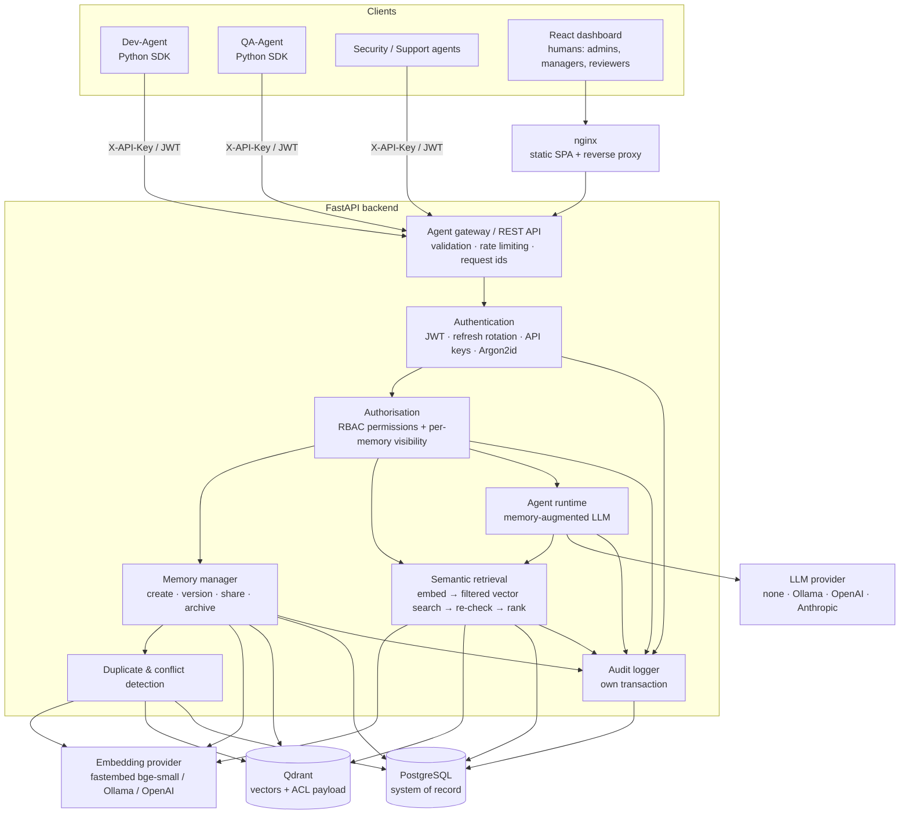

# Architecture

## 1. Context

AI agents working for different teams (development, QA, security, support …) normally keep private,
isolated memories. The same problem is investigated several times, decisions diverge, and knowledge
stays locked in a silo. The **Shared Memory Layer** is a service that every agent talks to instead of
talking to every other agent:

```
Agent A ──► Shared Memory ──► Agent B
```

It stores knowledge once, makes it retrievable **by meaning**, and releases it only to agents that are
authorised to see it.

## 2. Component view



| Layer | Implementation | Responsibility |
|---|---|---|
| Agent SDK | `sdk/shared_memory` (httpx), `sdk-js` (fetch) | authentication, `remember()`, `search()`, `update()`, `share()`, bulk import, retries on 429/5xx, token refresh; `sml` CLI; LLM tool definitions |
| MCP endpoint | `backend/app/mcp_server.py` | Model Context Protocol tools at `/mcp` for Claude Code, Cursor, VS Code, Claude Desktop — same auth, RBAC and audit as REST |
| Gateway | FastAPI routers `backend/app/api/routes` | request validation (Pydantic), rate limiting, consistent JSON errors, OpenAPI docs |
| Authentication | `backend/app/security/{tokens,passwords,dependencies}.py` | JWT access tokens (HS256, 15 min), rotating refresh tokens, agent API keys, Argon2id |
| Authorisation | `backend/app/security/access.py`, `permissions.py` | RBAC permission checks, memory visibility rules as Python, SQL and vector-filter form |
| Memory manager | `backend/app/services/memory_service.py` | lifecycle, versioning, sharing grants, feedback, verification, provenance |
| Semantic retrieval | `backend/app/services/search_service.py` | embedding, permission-filtered Qdrant search, authoritative re-check, ranking |
| Duplicate/conflict detection | `memory_service.detect` + `conflict_rules.py` | near-duplicate warnings, contradiction flags, review queue |
| Agent runtime | `backend/app/agents/runtime.py`, `backend/app/llm/providers.py` | task → search → context → LLM → answer → optional memory |
| Vector abstraction | `backend/app/vector/base.py`, `qdrant_store.py` | `VectorStore` protocol; Qdrant implementation; neutral `VectorFilter` |
| Embeddings | `backend/app/vector/embeddings.py` | `EmbeddingProvider` protocol; fastembed (default), Ollama, OpenAI |
| Persistence | SQLAlchemy 2 models + Alembic migrations | normalised schema, indexes, constraints, append-only audit trigger |
| Dashboard | React + Vite + TypeScript | monitoring, explorer, access control, audit, playground, review |

## 3. Request pipelines

### 3.1 Memory creation

```
POST /api/memories
 1 validate      Pydantic schema: lengths, tag format, metadata size, visibility/sensitivity rules
 2 authenticate  JWT or X-API-Key → Principal (agent or user, roles, permissions, team)
 3 authorise     memory:create; agent_id / team_id in the body must match the principal
 4 embed         title + content + tags → 384-d vector (bge-small-en-v1.5)
 5 detect        exact hash + semantic near-duplicates among *readable* memories;
                 organisation-wide candidates ≥ conflict threshold → contradiction rules
 6 store (PG)    memories row, tags, sharing grants, memory_versions v1, memory_conflicts (flush)
 7 store (Qdrant) upsert vector, point id == memory id, payload = ACL + filter fields
 8 commit        PostgreSQL commit; on failure the vector is deleted (compensation)
 9 audit         MEMORY_CREATE (+ DUPLICATE_DETECTED / CONFLICT_DETECTED)
10 respond       memory + warnings {duplicates, conflicts, message}
```

### 3.2 Hybrid semantic + keyword search

```
POST /api/memories/search
 query ─► embedding ─► Qdrant similarity search ─────────────► candidates
                         with filter = ACL(principal)            (never contains
                                 ∧ status/expiry                  unreadable memories)
                                 ∧ user filters (type, team,
                                   creator, project, tags, dates,
                                   confidence, verification)
 candidates ─► load rows from PostgreSQL ─► can_read() re-check ─► rank ─► top-k
 score = 0.90·similarity + 0.05·importance + 0.05·confidence (+0.02 if verified)
 ─► access counters (reuse if cross-team) ─► audit MEMORY_SEARCH ─► response
```

In the default `hybrid` mode a PostgreSQL full-text query (`websearch_to_tsquery`, every term must
match) runs under the *same* permission and metadata filters; its hits are merged with the vector
candidates, keyword-only hits get their true cosine similarity from Qdrant, and memories containing
every query term receive a +0.10 × normalised `ts_rank_cd` bonus. This catches exact identifiers
(error codes, CVE ids, ticket numbers) that embeddings blur, while natural-language queries (which
rarely match every term) are ranked by meaning as before. `semantic` and `keyword` modes run one half only.

If Qdrant is unreachable, search degrades to a permission-filtered keyword search
(`mode: "keyword_fallback"`) instead of failing.

### 3.3 Update & versioning

`PATCH /api/memories/{id}` locks the row (`SELECT … FOR UPDATE`), checks `can_modify`
(creator or manager of the owning team), optionally checks `expected_version`
(optimistic concurrency → 409), applies the changes, increments `current_version`, writes an
immutable `memory_versions` snapshot linked to the previous version, re-embeds if the text changed,
re-runs conflict detection and updates the vector. Search always returns the latest version because
there is exactly one vector per memory.

### 3.4 Memory-augmented agent runtime

```
Task ─► Agent (principal) ─► permission-aware search ─► relevant memories [M1..Mk]
     ─► LLM provider (system prompt + task + cited memories) ─► answer + "LEARNING:" line
     ─► optional: store the result as a task_result memory (parent = top memory)
```

With `LLM_PROVIDER=none` the runtime uses a deterministic extractive synthesiser over the retrieved
memories (clearly labelled `provider: extractive`). Ollama, OpenAI-compatible and Anthropic providers
are selected by environment variables; a failing provider falls back to extractive synthesis and
reports the reason.

## 4. Memory lifecycle

```
CREATE → VALIDATE → EMBED → STORE → RETRIEVE → USE → UPDATE → VERSION → ARCHIVE
                                                     ↑__________________|
```

* **Expiry** – `expires_at` hides a memory from standard retrieval (`include_expired=true` to see it).
* **Archive** – `DELETE /api/memories/{id}` archives; archived memories are visible to administrators only
  and can be restored. `?permanent=true` (administrators) removes the row and the vector.
* **Conflict resolution** – `keep_new` / `keep_existing` archive the losing memory; `keep_both`/`dismiss`
  close the flag without changes.

## 5. Consistency between PostgreSQL and Qdrant

PostgreSQL is the system of record. Every write follows *flush → vector write → commit* with a
compensating action if the commit fails; any divergence can be detected with
`GET /api/admin/consistency` and repaired with `POST /api/admin/reindex` (re-embeds every memory,
also used after changing the embedding model).

## 6. Replaceability (modularity)

| Concern | Interface | Implementations |
|---|---|---|
| Vector database | `VectorStore` protocol + neutral `VectorFilter` | `QdrantVectorStore` |
| Embeddings | `EmbeddingProvider` protocol | fastembed (local ONNX), Ollama, OpenAI |
| LLM | `complete(system, task, memories)` | extractive, Ollama, OpenAI-compatible, Anthropic |
| Rate limiting | `SlidingWindowLimiter.hit()` | in-process (swap for Redis in multi-replica deployments) |

## 7. Deployment view

`docker compose up --build` starts four containers on a private bridge network:

| Service | Image | Exposed |
|---|---|---|
| `postgres` | postgres:16-alpine (+ init script creating the test DB) | internal only |
| `qdrant` | qdrant/qdrant:v1.13.4 (API-key protected) | internal only |
| `backend` | python:3.12-slim + FastAPI/uvicorn, embedding model baked in, runs Alembic on start | `${BACKEND_PORT:-8000}` |
| `frontend` | nginx:1.27-alpine serving the built SPA, proxying `/api`, `/docs`, `/health` | `${FRONTEND_PORT:-3000}` |
| `ollama` (profile `llm`) | ollama/ollama | internal only |

The backend is stateless (except the in-process rate limiter) and can be scaled horizontally behind
nginx once the limiter is moved to Redis; Qdrant and PostgreSQL both support replication/sharding.

## 8. Observability

* JSON structured logs with a per-request `request_id` (propagated via `X-Request-ID`)
* append-only audit log (queryable in the dashboard and via `/api/audit-logs`)
* Prometheus metrics at `/metrics` (`sml_http_requests_total`, `sml_http_request_duration_seconds`)
* `/health` (database, vector DB, embedding model, LLM) and `/health/live`
* dashboard statistics computed live from PostgreSQL (`/api/dashboard/stats`)
