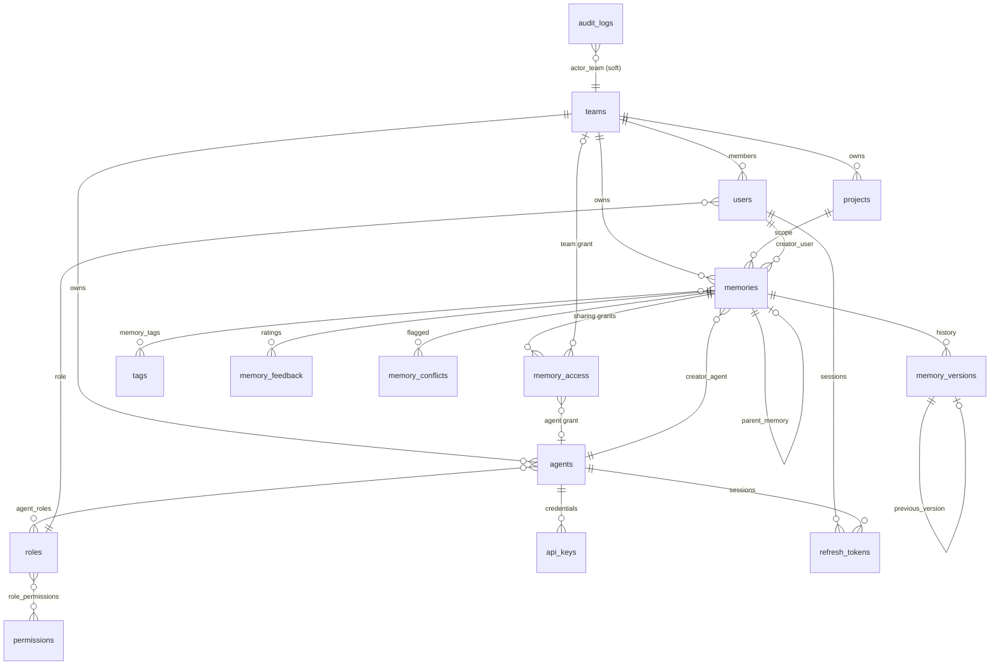

# Database design

PostgreSQL 16 is the system of record; Qdrant stores one vector per memory. The schema is created
exclusively by Alembic (`backend/alembic/versions/0001_initial_schema.py`, applied automatically by
the backend container on start). Enumerations are stored as `VARCHAR` with `CHECK` constraints so new
values can be added without `ALTER TYPE`.

## 1. Entity–relationship diagram



## 2. Tables

| Table | Purpose | Key columns / constraints |
|---|---|---|
| `teams` | organisational units | `name` & `slug` unique, `default_visibility`, `allow_cross_team_sharing`, `is_active` |
| `roles` | ADMIN, TEAM_MANAGER, AGENT, READ_ONLY | `name` unique, `is_system` |
| `permissions` | permission catalogue (`memory:create` …) | `code` unique |
| `role_permissions` | M:N roles↔permissions | composite PK, cascading FKs |
| `users` | human users | `username`/`email` unique, `password_hash` (Argon2id), `role_id`, `team_id`, lockout fields |
| `agents` | AI agent identities | `name` unique, `team_id`, `status` (active/suspended/deleted), `capabilities` JSONB, `persona`, `last_active_at` |
| `agent_roles` | M:N agents↔roles | composite PK |
| `api_keys` | agent credentials | `prefix` unique (indexed lookup), `key_hash` (keyed SHA-256), `expires_at`, `revoked_at`, `last_used_at` |
| `refresh_tokens` | rotating refresh tokens | `token_hash` unique, `family_id` (reuse detection), `replaced_by_id`, CHECK exactly one of `user_id`/`agent_id` |
| `projects` | optional scope for memories | `name` unique, `team_id` |
| `memories` | current state of each memory | see §3 |
| `memory_versions` | immutable snapshots | UNIQUE(`memory_id`,`version_number`), `previous_version_id` self-FK, author agent/user, `change_description`, content + metadata snapshot |
| `memory_access` | explicit sharing grants | CHECK exactly one of `team_id`/`agent_id`; UNIQUE(memory,team), UNIQUE(memory,agent) |
| `tags`, `memory_tags` | normalised tags | `tags.name` unique; composite PK |
| `memory_feedback` | usefulness ratings | CHECK `rating` 1–5, feeds `memories.reliability` |
| `memory_conflicts` | contradiction review queue | memory ↔ conflicting memory, similarity, reason, method, status, resolution, resolver |
| `audit_logs` | append-only audit trail | trigger rejects UPDATE/DELETE; GIN index on `metadata` |

## 3. `memories`

| Column | Type | Notes |
|---|---|---|
| `id` | UUID PK | also the Qdrant point id |
| `title`, `content` | varchar(200), text | validated & normalised |
| `content_hash` | char(64) | SHA-256 of normalised title+content (exact-duplicate lookup) |
| `search_tsv` | tsvector (generated) | `title` (weight A) + `content` (weight B), GIN-indexed — keyword half of hybrid search (migration 0002) |
| `memory_type` | enum | knowledge, decision, learning, experience, context, task_result, incident, documentation, solution |
| `creator_agent_id` / `creator_user_id` | FK | CHECK at least one set |
| `team_id` | FK | owning team |
| `project_id` | FK nullable | |
| `visibility` | enum | private, team, selected_teams, selected_agents, organization |
| `sensitivity` | enum | public, internal, confidential, restricted |
| `status` | enum | active, archived |
| `verification_status` | enum | unverified, verified, rejected (+ `verified_by_user_id`, `verified_at`) |
| `conflict_status` | enum | none, potential_conflict, resolved |
| `importance`, `confidence`, `reliability` | float | CHECK 0 ≤ x ≤ 1; reliability = Bayesian mean of feedback |
| `source`, `source_ref` | varchar | provenance (e.g. `agent`, `Agent task #1287`) |
| `metadata` | JSONB | ≤ 8 KB, owner-side only |
| `expires_at` | timestamptz | hidden from standard retrieval after expiry |
| `embedding_id`, `embedding_model` | varchar | vector link and model used |
| `parent_memory_id` | self-FK | derivation chain (e.g. agent task results) |
| `current_version` | int | equals the newest `memory_versions.version_number` |
| `access_count`, `reuse_count`, `last_accessed_at` | | reuse metrics (reuse = retrieval by another team) |
| `created_at`, `updated_at`, `archived_at` | timestamptz | |

### Indexes

`team_id`, `creator_agent_id`, `memory_type`, `created_at`, `visibility`, `status`,
`verification_status`, `project_id`, `expires_at`, `parent_memory_id`, `content_hash` and the composite
`(team_id, status, visibility)`; plus indexes on every foreign key of the association tables,
`audit_logs(timestamp)`, `(action, timestamp)`, `(status, timestamp)`, `(resource_type, resource_id)`,
`actor_id`, `actor_team_id` and a GIN index on `audit_logs.metadata`.

## 4. Vector collection (Qdrant)

Collection `memories` (cosine distance, 384 dimensions for `bge-small-en-v1.5`). Point id = memory id.
Payload (all indexed):

| Field | Used for |
|---|---|
| `team_id`, `creator_agent_id`, `creator_user_id`, `visibility`, `is_private`, `allowed_team_ids[]`, `allowed_agent_ids[]` | access-control filter |
| `status`, `expires_at_ts`, `verification_status` | lifecycle filters |
| `memory_type`, `project_id`, `tags[]`, `created_at_ts`, `confidence`, `importance` | metadata filters |
| `memory_id`, `version` | bookkeeping |

The payload is updated whenever sharing, status, verification or visibility changes, and the vector is
re-embedded when title, content or tags change.

## 5. Migrations

```bash
docker compose exec backend alembic upgrade head        # applied automatically at start-up (0001 schema, 0002 full-text search)
docker compose exec backend alembic history
docker compose exec backend alembic revision --autogenerate -m "describe change"
```
